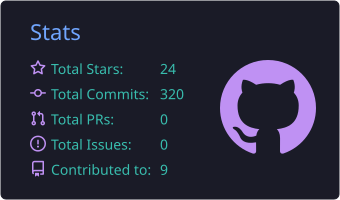
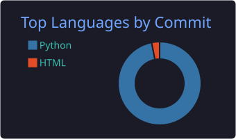
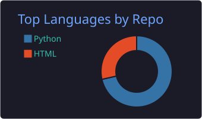
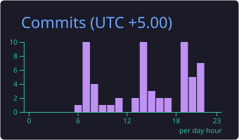

<!-- Header banner -->
<p align="center">
  
</p>

<!-- Typing animation -->
<p align="center">
  <a href="https://github.com/ASDprogrammer521">
    
  </a>
</p>

<p align="center">
  
  
  
</p>

---

## 👨‍💻 About Me

```text
{
  "name"      : "ASDcuber",
  "username"  : "ASDprogrammer521",
  "roles"     : ["Developer", "Ethical Hacker", "Speedcuber", "Calisthenics Athlete"],
  "languages" : ["Uzbek 🇺🇿", "English 🇬🇧"],
  "currently" : "Building programming projects & exploring security",
  "motto"     : "Just coder and ethical hacker"
}
```

- 🔭 Currently working on various programming projects and security explorations
- 🧠 Interests: Software Development, Ethical Hacking, Calisthenics, Speedcubing
- 🌐 Bilingual: Fluent in Uzbek and English
- 🎯 Goal: build tools that are useful, fast, and secure

---

## 🛠️ Tech Stack & Skills

**Languages**

<p>
  
</p>

**Security & Tools**

<p>
  
</p>

**Environments & Version Control**

<p>
  
  
</p>

---

## 🚀 Featured Projects

<!-- Repo nomlarini o'zingizniki bilan almashtiring -->

| Project | Description | Tech |
|---|---|---|
| 🤖 **[Jarvis AI](https://github.com/ASDprogrammer521/Jarvis-AI)** | Personal AI assistant with a HUD-style interface and voice/automation features | Python |
| 📊 **[Algorithm & Physics Visualizer](https://github.com/ASDprogrammer521)** | Interactive visualizations of algorithms and physics simulations | HTML / JS |
| 🌐 **[Network Visualizer](https://github.com/ASDprogrammer521)** | Local network & traffic monitor *(planned)* | Python |

---

## 🧩 Hobbies & Sports

<table>
  <tr>
    <td width="50%" valign="top">

### 🧩 Speedcubing
Solving Rubik's cubes at high speed and exploring algorithms.

- 🎲 Main event: 3x3
- ⚡ Focus: finger tricks, look-ahead, algorithms

</td>
    <td width="50%" valign="top">

### 🦾 Calisthenics
Bodyweight training: building strength, endurance, and advanced skills.

- 🤸 Handstand
- 💪 Planche progressions

</td>
  </tr>
</table>

---

## 📊 GitHub Stats

<p align="center">
  
  
</p>

<p align="center">
  
  
</p>

<p align="center">
  
</p>

---

## 🐍 Contribution Snake

<p align="center">
  
</p>

---

## 🤝 Connect

<p align="center">
  <a href="https://github.com/ASDprogrammer521"></a>
  <!-- <a href="https://t.me/USERNAME"></a> -->
</p>

<p align="center">
  
</p>
